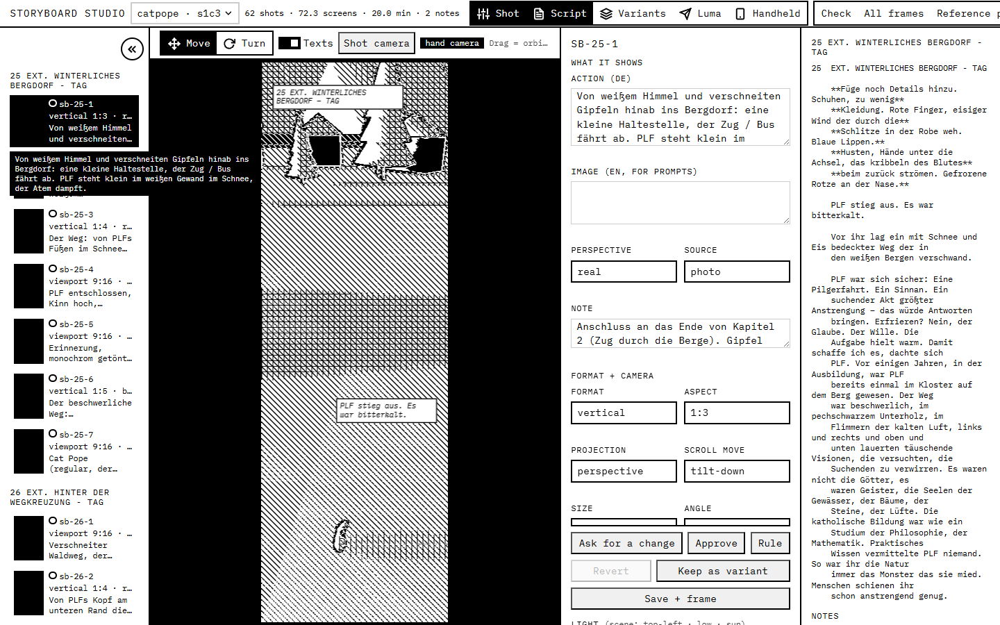
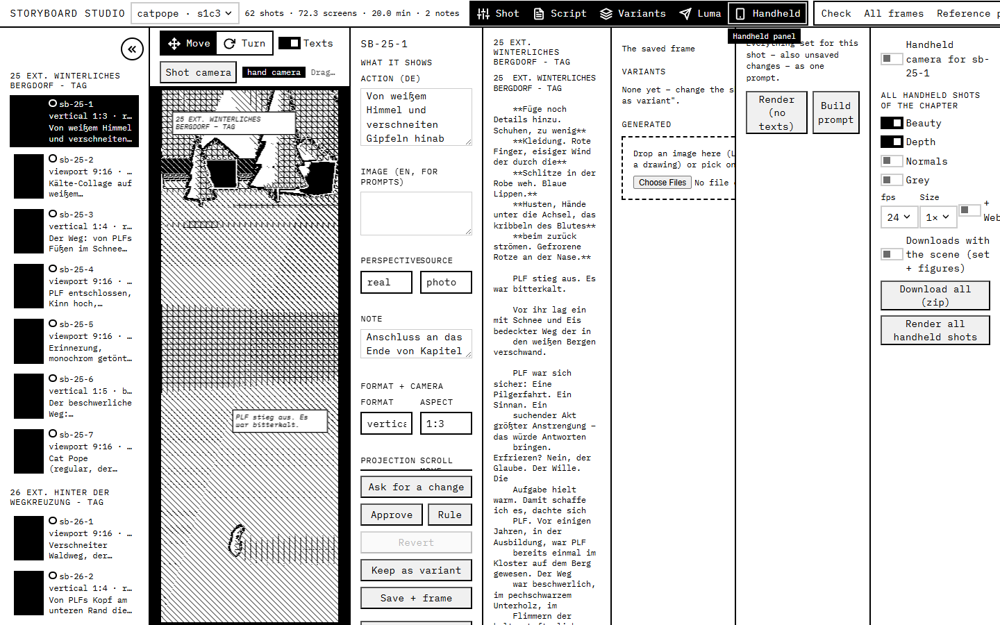
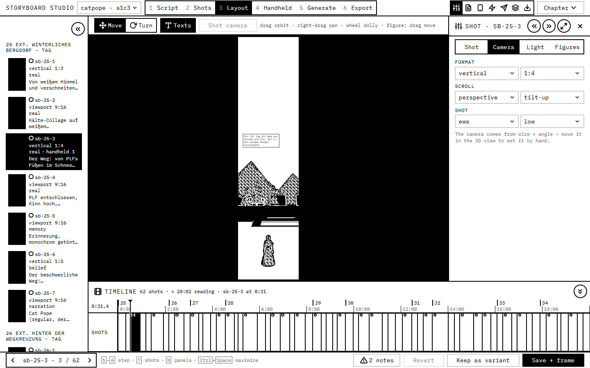
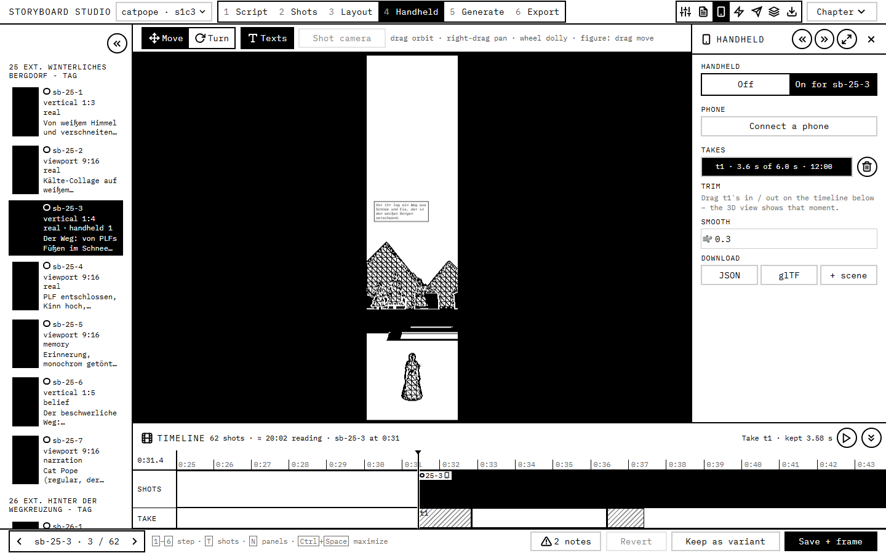
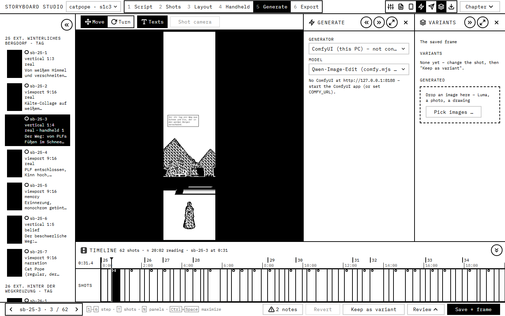
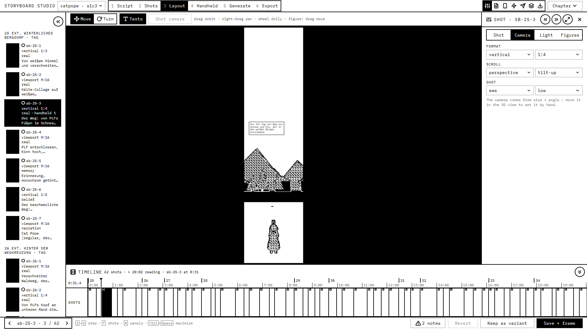

Status 2026-10-19: owner chose C in two stages – STAGE 1 BUILT (step tabs on the dock, panel heads, Chapter menu, ActionBar, compact Shot inspector, toasts, the timeline along the bottom – workflows/storyboard-studio README "The layout"); stage 2 (one tabbed inspector with pin, the main's 3D / Frames / Compare) open. Owner answers: §6 below.

# STUDIO-LAYOUT – a clearer storyboard studio (research, 2026-10-19)

Owner 2026-10-19 (translated): "Please run a design research on how the studio can look better. The creator page etc.
has been through several design iterations now. It makes sense to pick up those concepts and learnings and design the
studio more clearly. Maybe not all steps need to be visible at once. I imagine something more like Blender, with panels
I can freely show when I need them."

Mockups (static HTML on the real tokens, open them in a browser): `research/studio-layout/concept-*.html`
(`mock.css` = the frame pieces only). Screenshots of the studio as it is: `studio-layout/current-1440-*.png`.

## 1. The studio today (workflows/storyboard-studio, 1440 and 1920 wide)

One AppShell: the shot list (sidebar) | the 3D view (page) | five dock panels (Shot, Script, Variants, Luma, Handheld)
switched by a segmented row in the top bar, next to the four script buttons (Check, All frames, Reference packs,
Chapter draft). Default: Shot + Script open.

 

1. **Everything at once, no order.** Five panels for five different moments of the work (blocking, script, choosing
   variants, prompting, filming with the phone) are peers in one row; nothing says which belong to which step.
2. **Opened together they squeeze** (all five at 1440): each panel is 10–13rem, the Shot form's labels collide
   ("PERSPECTIVESOURCE"), values are cut ("vertica"), the script wraps per word, the 3D view shrinks to ~19rem.
3. **The panels have no head**: no title, no `DockFold`, no maximize, no ✕ – the creator's panels all have them
   (DOCKING "Several panels" 2). They close only through the top-bar toggles; a folded / squeezed panel is hard to name.
4. **The top bar overflows** at 1440: "Reference packs" and "Chapter draft" are cut off (the bar scrolls sideways) – five
   toggles and four script buttons compete with the chapter and the summary.
5. **The Shot panel is one long form** (what it shows, format + camera, light, figures) with six action buttons inside
   the panel; at 1440 the action stack lies over the Size / Angle fields. Save / review are page actions – in the
   creator they are the ActionBar's (DESIGN "The bottom bar is grouped", one primary).
6. **Pre-compact fields**: stacked `Field` + select, native range sliders for azimuth / elevation / softness, plain number
   inputs for x / y / h, a native "Choose Files" in Variants, checkbox toggles; the 3D view's hint is cut ("Drag = orbi…").
7. **Messages** are a fixed black box at the bottom left, not the shared notifications (DESIGN "Notifications").
   (The black thumbnails are this checkout's missing frames, not a layout problem.)

## 2. Research (briefly)

| Tool | What it does | What fits the studio |
|---|---|---|
| **Blender** – areas / editors | The window is tiled into **areas**; each holds an **editor** chosen by the editor-type menu at the left of its header. Drag a corner inward = split, outward = join; right-click a border = area options (split, join, swap); borders drag. **Workspaces** (tabs on top: Layout, Modeling, Shading, Animation …) are saved area layouts per task. Inside an editor, **regions**: toolbar (T), sidebar (N), header with **menus**; **pie menus** on a key; Ctrl+Space maximizes an area. The Properties editor sorts its many settings into a **vertical icon tab column**. | Workspaces per task = steps; T / N toggles; Ctrl+Space (we already use it); the tab column for many settings of one object. Free split / join was explicitly *not* taken for the creator (DOCKING "Why"). |
| **DaVinci Resolve** – pages | One page per stage (Media, Cut, Edit, Fusion, Color, Fairlight, Deliver) in a bar at the bottom, Shift+1…9; each page is a fixed, purpose-built layout over the same project; unused pages can be hidden. | The closest match to a linear pipeline: **steps as pages over the same chapter**, a number key each, the last one = Deliver (our Export). |
| **Unreal Engine** – dockable tabs | Every tool is a tab that docks anywhere in its editor; layouts save / load (`FLayoutSaveRestore`, per ini). | Power, but every panel becomes a tab that can be lost; too much chrome for a one-person tool. |
| **Godot** – docks | Docks move between fixed slots, float, and **Editor Layouts** save / restore the arrangement by name. | Named layouts = per-step presets; fixed slots (not free tiling) keep it simple. |
| **Figma UI3** | Left navigation + right properties; "Minimize UI" folds both (Shift+\ / Ctrl+\); selecting on the canvas brings the properties back. Users miss folding one side only. | Fold each side on its own (we have it: Ctrl+\ and the dock's rails). |
| **ShotGrid / Frame.io** (general knowledge, not re-checked) | Shot lists as thumbnails + a status per shot through the pipeline; review = a viewer that compares versions and records approve / request changes. | The shot list's status dot everywhere; a Compare view for "generate → approve". |

Sources: [Blender areas](https://www.blender.org/manual/en/interface/window_system/areas.html),
[Blender workspaces](https://docs.blender.org/manual/en/latest/interface/window_system/workspaces.html),
[Blender regions (T / N)](https://docs.blender.org/manual/en/latest/interface/window_system/regions.html),
[Blender properties editor](https://docs.blender.org/manual/en/latest/editors/properties_editor.html),
[Resolve pages + shortcuts (TourBox)](https://www.tourboxtech.com/en/news/davinci-resolve-fusion.html),
[Resolve manual (mirror, chapters per page)](https://mans.io/files/viewer/2187309/1011),
[Unreal interface overview](https://docs.unrealengine.com/4.27/Basics/UI/InterfaceOverview),
[Unreal FLayoutSaveRestore](https://dev.epicgames.com/documentation/unreal-engine/API/Runtime/Slate/FLayoutSaveRestore/LoadFromConfig),
[Godot editor layouts](https://docs.godotengine.org/en/stable/tutorials/editor/customizing_editor.html),
[Figma: hide one side only (forum)](https://forum.figma.com/suggest-a-feature-11/bring-back-independent-left-right-panel-collapsing-as-in-ui2-42703),
[Figma: navigating UI3](https://figma-signup.helpjuice.com/navigating-ui3-figma-s-new-ui).

**The workflow** (research/STORYBOARD.md, HANDHELD-CAMERA.md): script → shots → layout / camera → handheld takes →
generate → approve → export. Each step needs the shot list (which shot, its status) and ONE main view; the rest is a
different set of settings per step. That is Resolve's pages + Blender's workspaces, not free tiling.

## 3. Learnings to reuse from the creator

- **One layout model** (DOCKING.md): regions tile, one `Divider` per edge, one fold to a `Rail`, panel heads with
  `DockFold` + `MaximizeButton` + ✕, fixed places (`DOCK_ORDER`), the least recently used folds first when the room runs
  out, maximize = fold everything else (Ctrl+Space), Ctrl+\ (sidebar), Ctrl+Shift+\ (fold the main), widths per kind in
  localStorage – all in `@scutoons/ui` (AppShell, `useDock`, `panelWidth`, `dockRegion`), the studio already uses it.
- **Panels across pages** (DOCKING, `DockContent` / `DockHold`): a docked kind stays MOUNTED when the next page docks
  the same kind – the same trick keeps the 3D view's WebGL, the phone link and a panel's scroll across step changes.
- **Compact inspector** (DESIGN "Compact inspector", research/EDITOR-INPUTS.md): `PropRow`, `ScrubNumber` (+ units),
  `Segmented`, `PropSelect`, `ColorField`, `FieldReset` – every control `--control-height`, the label inside the row.
- **The ActionBar** (DESIGN "The bottom bar is grouped"): page actions in one bottom bar, grouped, one primary last;
  it stays while something is maximized. Confirmations in-page (`askDialog`), notifications instead of a fixed box.
- **Brutalist tools** (DESIGN): 2px ink frames, square tab rows / segments with the chosen one inverted, round
  icon-only buttons, the tool label, bold only for h1, rem only; "less UI is better UI" – no duplicate controls.
- **Phones / tabs precedent**: the creator's inspector on a phone is a sheet whose head is a tab row (`BarTabs`) – an
  existing pattern for "one inspector, several tabs".

## 4. Concepts

Effort = agent days, with checks; all keep `@scutoons/tokens` and the studio's 90 % root.

### A – Blender areas (free tiling + editor types + workspaces)
Mockup: [concept-a-areas.html](studio-layout/concept-a-areas.html)
- **Layout**: the window is a split tree of areas; each area's header starts with an editor-type button (3D view, Shot
  list, Frames, Compare, Shot properties, Script, Variants, Generate, Handheld, Take timeline, Output) followed by that
  editor's menus. Workspace tabs on top (Script … Export, +) are saved trees. Header menus Chapter / Shot / View / Render
  replace the script buttons.
- **Open / close / dock / resize**: drag a corner in = split, out = join; right-click a header = split / join / swap;
  every edge a `Divider`; an editor appears by switching an area's type (no "open" as such).
- **Keys**: Ctrl+Space maximize area (= today), Ctrl+PgUp / PgDn workspace, T / N inside the 3D view.
- **Smaller screens**: a tree saved at 1920 breaks at 1440 – areas need minimum sizes and a "fit" rule; < 1024 one area
  at a time.
- **Reuses**: `Divider`, `MaximizeButton`, the compact inspector. **Not** AppShell / `useDock` – a new `AreaTree` in
  `@scutoons/ui` (or studio-local), its own persistence per workspace.
- **Effort** 7–9 days. **Risks**: leaves the shared layout model (DOCKING "not taken: free splitting / editor-type
  switching"); chrome in every area; two 3D views = two WebGL contexts; split / join gestures need much testing; every
  editor must work at any size.

### B – Step tabs on today's dock (Resolve pages)
Mockup: [concept-b-steps.html](studio-layout/concept-b-steps.html)
- **Layout**: unchanged AppShell (shots | 3D view | dock). The top bar gets the **step tabs** 1 Script · 2 Shots ·
  3 Layout · 4 Handheld · 5 Generate · 6 Export (square tab row, the current one inverted); right of it the panels of the
  step as an icon segment and a **Chapter ▾** menu (Check, All frames, Reference packs, Chapter draft, Render all
  handheld shots). Save / Revert / Keep as variant / Review ▾ move into a bottom **ActionBar** with the shot stepper
  (‹ Shot 1 / 62 ›) and the notes; Save + frame is the one primary.
- **Steps** = a remembered set of dock panels per step (localStorage `storyboard-studio:step:<id>`): Script = Script +
  Shot (what it shows); Shots = Shot; Layout = Shot (camera / light / figures); Handheld = Handheld; Generate = Luma /
  the generator + Variants; Export = Output. Toggling a panel changes the current step's set only; a step never hides
  a panel the person opened in it.
- **Panels** get the creator's head (icon, title, `DockFold`, maximize, ✕) and the compact inspector; the Shot panel is
  split into its sections (or B's Shot stays one panel with the sections – the mockup).
- **Keys**: 1–6 step (outside text fields, no modifier), T shot list (alias of Ctrl+\), N fold / unfold the step's
  panels, Ctrl+Space maximize, Ctrl+Shift+\ fold the 3D view – all shown in the bar's key hints.
- **Smaller screens**: each step's default fits 1440 (15rem shots + ≥ 24rem main + one 24–26rem panel); more panels follow
  DOCKING's squeeze (least recently used folds first); < 1024 the shot list starts on its rail; < 768 AppShell's phone
  behaviour (not a target – the phone has `/phone`).
- **Reuses**: AppShell, `useDock`, `panelWidth`, `DockFold`, `MaximizeButton`, `ActionBar`, `Segmented`, the compact
  inspector, notifications, `askDialog`.
- **Effort** 2–3 days. **Risks**: still panels side by side when many are opened (the squeeze copes); the step tabs are
  presets, so the person must trust that nothing is lost when switching (panels held mounted, DOCKING "across pages").

### C – Hybrid: steps + one tabbed inspector + a main that switches (recommended)
Mockups: [Handheld step](studio-layout/concept-c-hybrid-handheld.html), [Generate step](studio-layout/concept-c-hybrid-generate.html)
- **B's step tabs, Chapter menu and ActionBar**, plus:
- **ONE inspector** in the dock with Blender's **vertical icon tab column**: Shot · Camera · Light · Figures · Script ·
  Handheld · Generate · Variants (the generator panel being built now becomes the Generate tab's content). A step picks
  its tab; the person can switch freely. **Pin** (round button in the head) docks the current tab as its own panel next
  to the inspector (`useDock` kind `storyboard-<tab>`) – e.g. Script beside Camera – so "panels I can freely show" stays.
- **The main switches its editor** (Blender's editor type, only for the main): 3D · Frames (all shots as a grid, the
  rhythm) · Compare (the blocked render next to the generated candidates; ← → pick, Enter choose). Generate opens
  Compare, the other steps 3D.
- **A bottom region inside the main only where a step needs time**: the take trim in Handheld (`TakeTimeline` exists),
  later maybe the chapter's rhythm strip – a page split with a horizontal `Divider` (like the chapter editor's
  inspector region), not a shell bottom region (DOCKING decision 2 stays).
- **Per-step state**: the inspector tab, the main editor, the pinned panels and the shot list's fold; the selected shot
  is shared by all steps.
- **Keys**: B's, plus Alt+1…8 inspector tab, and per step its own (R record in Handheld, Enter choose in Generate).
- **Smaller screens**: like B; the tab column (2.75rem) costs less than a second panel; at 1280 the shot list folds first
  in Generate (the mockup shows it on its rail).
- **Reuses**: everything B reuses + `BarTabs`' pattern for the tab column (a new desktop variant), `resizable` for the
  bottom split, `TakeTimeline`, `VariantsPanel` content.
- **Effort** 4–6 days (B 2–3 + the inspector tabs and pin 1–1.5 + Frames / Compare 1.5–2 + the trim region 0.5).
  **Risks**: the tab column is a new shared pattern (needs a DESIGN entry: square, inverted, icon + tooltip); pin vs tab
  must not create two places for one panel (a pinned tab leaves the column while pinned); Compare overlaps with the
  generator panel being added now – build after it lands.

## 5. Recommendation

**C, built in two stages.** Stage 1 is B (2–3 days) and already fixes problems 1–7: steps, panel heads, the Chapter
menu, the ActionBar, the compact inspector, notifications. Stage 2 adds the tabbed inspector with pin, the main's
3D / Frames / Compare switch and the trim region, once the generator panel has landed. Not A: the owner's "panels I can
freely show" is met by toggles + pin + rails + maximize on the shared model; Blender's free split / join costs three
times as much, leaves the layout model the creator settled on (DOCKING "Why") and adds chrome to every area. A's good
parts – workspaces per task, T / N, editor types, the tab column – are in C.

## 6. The owner's answers (2026-10-19) and stage 1 as built

- **C in two stages**; stage 1 = B now. Steps as recommended (six; approving inside Generate; the review dots in every
  step); keys as recommended (1–6, T, N; Ctrl + Space, Ctrl + \, Ctrl + Shift + \ stay); a step remembers panels,
  inspector tab, main view, widths, the selected shot shared – and "it makes sense for it to always look the same".
- **The timeline stays** (owner: "Actually the timeline underneath the other windows was also good – not sure if the
  concept I chose killed that"): a region along the bottom UNDER the main view AND the panels (the AppShell's bottom
  region, DOCKING "Bottom region" – this replaces C's "bottom region inside the main only"), in every step (folded in
  Script / Export by default), its height remembered. Then: "this has to be compatible with creator and anything we plan
  for live performance", "best place it is part of creator" → the shared, creator-ready Timeline (research/TIMELINE.md):
  a linear axis with zoom, a shot = its reading time, the take on the chapter's axis.
- **Built** (stage 1): the six step tabs + the step's panel toggles + the Chapter menu in the top bar (no overflow at
  1440); the panels with the creator's head in fixed places (Shot · Script · Handheld · Generate · Luma · Variants ·
  Output); the Shot panel as a compact inspector in four tabs (Shot, Camera, Light, Figures – stage 2's tab column
  in waiting); the ActionBar (‹ shot ›, measures, keys, notes, Revert, Keep as variant, Review in Generate, Save + frame);
  the handheld chapter renders + zip in the Export step's Output panel; the toasts.
- Not built (stage 2): the inspector's tab column with pin, the main's Frames / Compare, Alt + 1…8.
- Checked: a review in four lenses with adversarial verification (30 findings fixed, each track rechecked), all six steps
  at 1440 and 1920:  
   
  (the white frames are this checkout's missing renders).

## 7. The questions as asked (kept for the record)

1. **Steps**: Script · Shots · Layout · Handheld · Generate · Export, approving inside Generate? – Recommended: yes, six;
   the shot list's dots show the review status on every step.
2. **Inspector**: one panel with a tab column + pin (C), or separate panels side by side as in the creator (B)? –
   Recommended: tabs + pin.
3. **Keys**: plain 1–6 for the steps and T / N for shot list / inspector (Blender-like, only outside text fields)? –
   Recommended: yes; Ctrl+Space, Ctrl+\ and Ctrl+Shift+\ stay as they are.
4. **Free splitting (A)** at all? – Recommended: not now; revisit if the step presets feel tight after a month of use.
5. **What a step remembers**: panels + inspector tab + main view + widths per step, the selected shot shared? –
   Recommended: yes.
